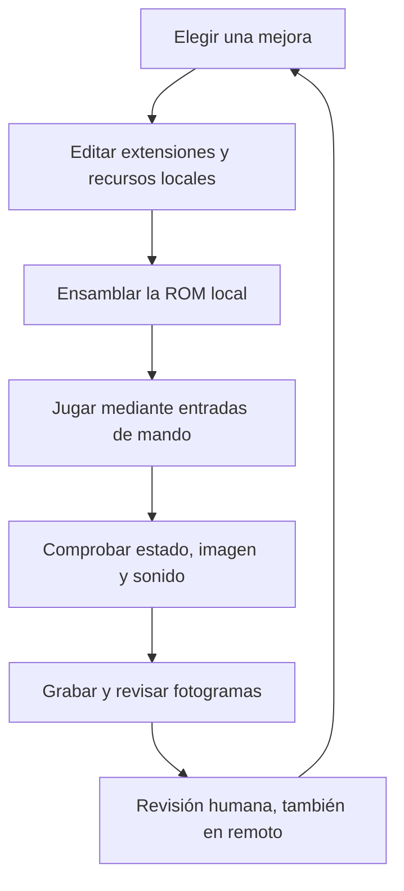
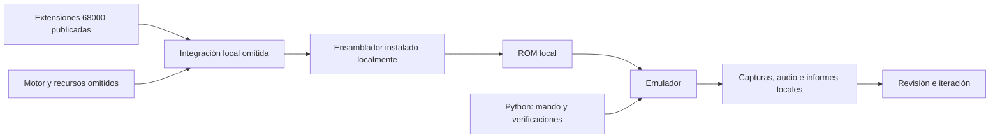

# Antes de usarlo: archivos que no se publican

**Este repositorio no contiene una ROM jugable ni una distribución completa del juego.** Se han omitido los recursos de terceros y los datos privados. La copia pública permite estudiar las extensiones del motor, las herramientas y el proceso de desarrollo; no puede compilar la hack ROM tal como está.

| Falta | Ubicación que utiliza la copia local | Para qué se necesita |
| --- | --- | --- |
| ROM original y ROM modificada; parches IPS | `build/`, archivos `.bin` y `.ips` | Ejecutar el juego, comparar resultados y probarlo. Los parches también contienen recursos omitidos. |
| Desensamblado original y fuentes completas regeneradas | `source/`, `game/` | Reconstruir el motor. No se redistribuyen código ni datos del juego original. |
| Arte, animaciones, retratos, mapas y referencias de Golden Axe y Naruto | `assets/`, `reference-32x/` | Preparar los gráficos. También se omiten los atlas generados que representan personajes o escenarios de esas obras. |
| Integrador, generadores de ese arte y guion de la adaptación | Archivos enumerados en [omitted-scripts.json](docs/omitted-scripts.json) | Unir las extensiones al desensamblado y producir los recursos de la adaptación. |
| Ensamblador, emuladores y editor de sprites | `source/AS/`, `tools/` | Compilar, ejecutar, verificar y editar. Deben instalarse por separado desde sus proyectos oficiales. |
| Gameplay, capturas, audio grabado y copias de seguridad | `build/`, medios multimedia | Revisar visualmente la versión privada. No se publican vídeos ni imágenes del juego. |
| Credenciales, contactos, rutas personales y enlaces privados | No tienen ubicación pública | No son necesarios para estudiar el proyecto. |

Para reconstruir una versión local hacen falta **todos** sus componentes omitidos y permisos para utilizarlos, no solamente una ROM base. El repositorio no ofrece descargas de esos materiales ni un instalador que los obtenga. [Dependencias locales](docs/LOCAL_SETUP.md) describe los requisitos y las limitaciones.

---

# Golden Axe Custom

Herramientas, extensiones en ensamblador Motorola 68000 y documentación de un experimento de desarrollo asistido por IA para Sega Mega Drive / Genesis.

El proyecto local transforma Golden Axe en una aventura de una sola fase inspirada en Naruto: Kakashi recorre Konoha, combate con kunai y jutsus y se enfrenta a Itachi dentro de un genjutsu. Conserva buena parte del comportamiento del motor original, pero modifica personajes, escenario, interfaz, combate, historia y sonido. Esta publicación recoge el código propio seleccionado y el método de trabajo, con el contenido excluido indicado arriba.

La base es un **desensamblado 68000 existente**, atribuido a Lorenzo / lory1990. No se ha decompilado el juego a C desde cero. Las referencias al original y a la serie describen el experimento; esta publicación no incluye sus recursos ni implica afiliación con sus titulares.

## Cómo se desarrolló

La iteración combina cambios de código, partidas reales en emulador, inspección del estado del motor y revisión de vídeo. El código está visible, pero entender qué provoca un cambio exige observar cómo se relacionan sus rutinas, memoria y límites gráficos.



Codex implementa cambios y ejecuta las herramientas. Las pruebas contrastan comportamientos concretos; el vídeo ayuda a detectar problemas de escala, animación, composición o impacto. En el trabajo remoto, las grabaciones se revisan en Drive y las indicaciones humanas orientan otra vuelta del bucle. La integración de Drive y sus enlaces privados no forman parte de esta copia.

## Qué contiene la publicación

- **Extensiones 68000 propias:** combos, selección de técnicas, reacción al daño, HUD, streaming del escenario, animación, audio y control del presupuesto de sprites. Son módulos de integración, no un motor independiente.
- **Frontend libretro en Python:** manda entradas de control a un núcleo instalado localmente, captura imagen y audio y permite leer memoria para comprobar resultados.
- **Pruebas de integración:** controles, combos, jutsus, objetos, jefe, diálogos, sonido y límites del VDP. Dependen de la ROM y los recursos locales omitidos.
- **Herramientas genéricas:** validación de cabeceras y checksum de ROM, creación y comprobación de IPS, asignación de tiles, generación de audio FM/PSG y revisión de fotogramas.
- **Montaje de vídeo:** scripts de composiciones de 20 y 60 segundos, incluida una variante editorial. Los scripts están publicados; sus entradas y vídeos resultantes no.
- **Control de publicación:** auditoría de los archivos permitidos y comprobación de los requisitos locales.

## Diseño de la versión local

La última versión estable que documenta esta copia es **v0.29**. El modo es de un jugador y dificultad muy fácil. Las funciones descritas pertenecen al proyecto local y no significan que el juego esté incluido aquí.

| Sistema | Comportamiento del proyecto local |
| --- | --- |
| Movimiento | Marcha, carrera por doble toque y salto; animaciones que respetan los estados del motor. |
| Combate | Puño, kunai y remate; variantes de avance, barrido y uppercut; retroceso, derribo y recuperación. |
| Técnicas | Raikiri, Kamui, Chidori, Katon, Suiton, Doton y Ninken; selector separado del lanzamiento. |
| Escenario | Recorrido de 2560 × 224, sectores, habitantes, objetos sólidos y rompibles, pergaminos y cambios de iluminación. |
| Historia y jefe | Diálogos con retratos; Itachi tiene 60 puntos de vida, clones con menos vida, cuervos, fuego y otra fase. |
| Audio | Composiciones y efectos sintetizados para YM2612 / SN76489; no se usan grabaciones de la serie. |

## Arquitectura



La plataforma utiliza una imagen de 320 × 224, tiles de 8 × 8 y paletas limitadas. La gestión de VRAM, DMA, orden de sprites y profundidad afecta tanto a la fluidez como a la legibilidad del combate. [ARCHITECTURE.md](docs/ARCHITECTURE.md) explica la estructura y las dependencias entre módulos.

## Empezar

Python 3.10 o posterior. El flujo original utiliza Windows y PowerShell; el frontend espera un núcleo libretro de Windows instalado localmente.

```powershell
python -m venv .venv
.\.venv\Scripts\Activate.ps1
python -m pip install -r requirements.txt
python scripts/audit_public_tree.py
python scripts/check_local_requirements.py
```

La auditoría de publicación funciona sobre la copia pública. La comprobación de requisitos informa de los componentes omitidos y devuelve un código distinto de cero si faltan. No descarga nada ni modifica la memoria del juego.

`Check-All.ps1`, `Build.ps1`, `Prepare-Assets.ps1` y `Play.ps1` conservan el flujo de la copia local. **No son ejecutables de extremo a extremo con este checkout**: el integrador y los recursos están excluidos. Después de completar una instalación autorizada, `GA_PYTHON` permite elegir el ejecutable de Python que usan los scripts de PowerShell.

## Verificación y límites

La v0.29 local pasó 34 comprobaciones en emuladores. La partida de referencia duró 161,93 segundos y terminó en victoria; se decodificó completa y se revisaron fotogramas de movimiento y combate. Estos resultados describen la versión privada de referencia; no son una validación de un juego reconstruido desde este repositorio público.

Siguen existiendo errores y desigualdad visual: transiciones entre marcha y carrera, efectos que cubren al personaje, repeticiones del escenario y aspectos de la interfaz. Las pruebas funcionales no garantizan una estética coherente ni una buena sensación de combate. No hay verificación en hardware físico ni cobertura de todos los estados posibles.

El experimento muestra autonomía en determinadas tareas de desarrollo, junto con la necesidad de selección, revisión y corrección humanas. No se presenta como un juego terminado.

## Publicación y derechos

La publicación se ha construido con una lista de archivos permitidos y un historial nuevo. No se han trasladado los archivos excluidos a commits antiguos, Git LFS ni releases. El resto del proyecto y las copias de seguridad permanecen fuera de este repositorio.

El código original incluido se publica bajo [MIT](LICENSE). Esa licencia cubre los archivos de esta publicación, no el juego original, sus recursos, Naruto, los materiales omitidos ni los programas externos. Los nombres de obras y personajes se conservan como referencias descriptivas del experimento.

Consulta [PUBLICATION.md](docs/PUBLICATION.md) antes de añadir archivos. Las contribuciones deben incluir solo código y recursos propios o con autorización de redistribución; no envíes ROMs, arte de terceros, capturas del juego, credenciales o enlaces privados.
